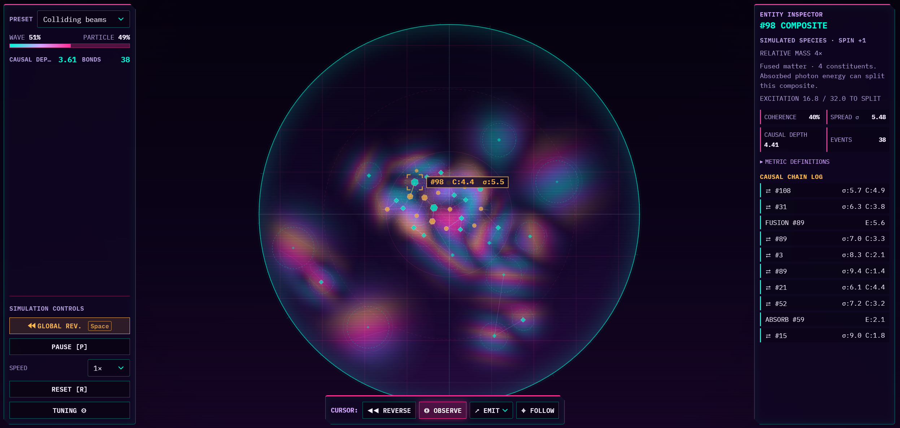

# Kyonami

A quantum-inspired playground of waves, particles, and light, packaged as a web component.

[Open the app](https://jjjpanda.github.io/kyonami/) · [Embed view](https://jjjpanda.github.io/kyonami/embed/)



## Waves and particles

Waves overlap and interfere. Observation and interactions draw them into particles; isolation and Reverse let them spread again. Matter can fuse into larger particles or split after absorbing light.

| Particle | Behavior |
| --- | --- |
| Spinner | Opposite spins attract; matching spins repel. |
| Binder | Helps particles form groups and rings. |
| Drifter | Moves easily between groups, forming weak bonds. |
| Anchor | Attracts groups; splits after absorbing enough light. |
| Photon | Carries energy through the field and transfers it to matter on contact. |

## Controls

Choose a cursor mode, then interact with the field:

| Mode | Action |
| --- | --- |
| Reverse | Hold to let nearby particles spread back into waves. |
| Observe | Hold to draw nearby waves into particles. |
| Emit | Choose a particle, then click to place it or drag to launch it. |
| Follow | Click a particle to follow it. |

Click a particle to inspect it. Hold **Space** to apply Reverse everywhere. **P** pauses; **R** resets.

## Embed

### Hosted iframe

```html
<iframe
  src="https://jjjpanda.github.io/kyonami/embed/?preset=causal-crystal&amp;theme=citypop"
  title="Kyonami simulation"
  width="800"
  height="450"
  loading="lazy"
  style="border: 0"
></iframe>
```

The field fills the iframe with compact controls. Set its dimensions in the parent page.

The URL accepts `preset`, `theme` (`citypop`, `cyber`, `daylight`), `speed` (0.25–8), and `seed`. Add `autoplay=false` to start paused or `transparent=true` for a transparent background.

### Web component

Serve `src/` alongside your page:

```html
<script type="module" src="./src/main.js"></script>
<div style="height: 450px">
  <kyonami-chamber embed preset="causal-crystal" theme="citypop"></kyonami-chamber>
</div>
```

Omit `embed` to show the full interface. Change attributes with `setAttribute()`.

## Development

Requires Node 22 or newer. No runtime packages are required.

```sh
npm ci
npm run dev
npm test
npm run build
```

Open `http://127.0.0.1:4186`. `npm run check:http` checks the build; `npm run check:browser` runs browser checks. `npm run benchmark` measures simulation performance.
